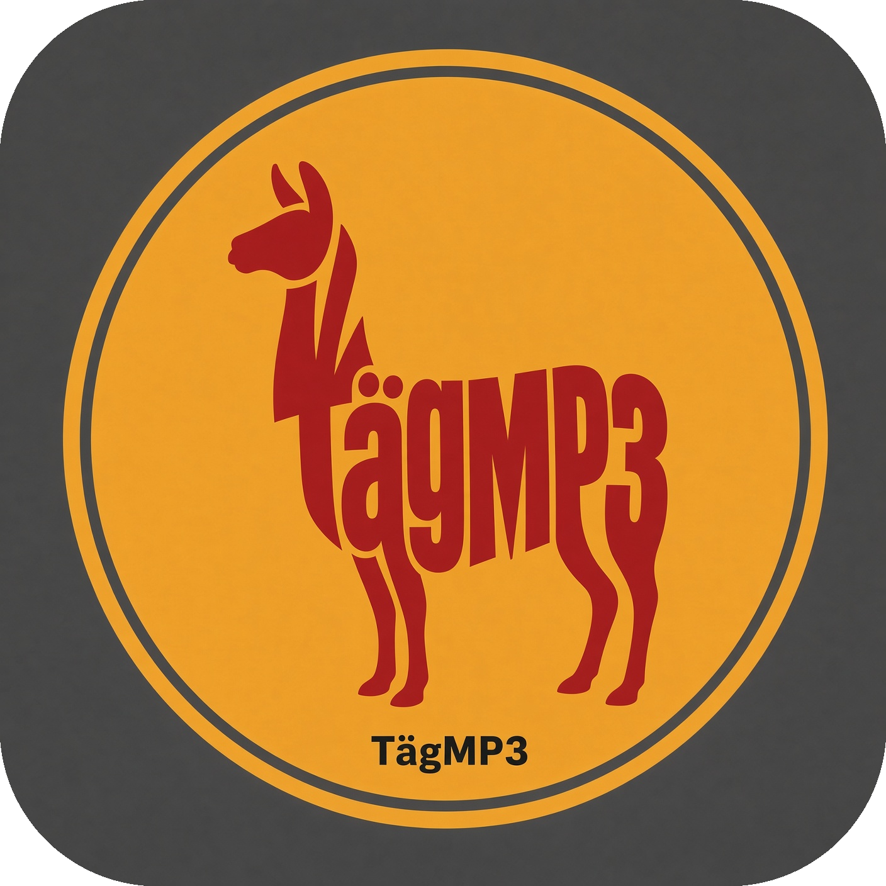

# tagmp3

`tagmp3` is a native macOS application for inspecting, editing, and organizing
metadata in local audio files.



## Current development build

The first vertical slice supports:

- opening supported audio files or folders, including drag and drop;
- inspecting common tags and technical audio properties;
- staging single-file and batch metadata edits;
- front-cover JPEG/PNG artwork replacement, removal, import, export, and drag;
- front-cover artwork paste from the macOS clipboard for one or all selected
  tracks;
- sequential track numbering and previewed filename renames;
- filtering, sorting, staged undo/redo, Save All, and discard changes.
- a discreet local audio preview player with play/pause, seeking, volume, and a
  Spacebar shortcut for the selected track;
- MusicBrainz/Cover Art Archive lookup with explicit field/artwork staging and
  alignment warnings for ambiguous or mismatched filenames.

The development reader also recognizes FLAC, Ogg Vorbis/Opus, M4A/MP4/ALAC,
WAV, and AIFF. APE, WavPack, and DSF are exposed as experimental formats;
format-specific support remains capability-driven and community validation is
welcome.

Edits are staged until explicitly saved. Files are written through a temporary
sibling and atomically replaced after verification.

## Build and test

Requirements: macOS 13 or newer and the installed Xcode toolchain.

```sh
./scripts/test.sh
```

Pull requests and pushes to `main` run the same test entry point on the macOS 15
Intel GitHub Actions runner through `.github/workflows/test.yml`. Release signing,
notarization, and the separate universal-binary workflow remain intentionally
deferred.

For a build without running Xcode tests:

```sh
xcodebuild -project TagMP3/TagMP3.xcodeproj \
  -scheme TagMP3 -destination 'platform=macOS' \
  CODE_SIGNING_ALLOWED=NO build
```

The current development project is configured for `x86_64`; an arm64-only
cross-build succeeds, but universal package integration remains release work.
Distribution signing, notarization, and release verification are also later
release work.

The preview player uses the native macOS audio stack. Ogg Vorbis and Opus
metadata are supported, but their audio preview may be unavailable on systems
where that stack cannot decode those containers.

## Release-candidate checklist

Before publishing a release, maintainers should:

- run `./scripts/test.sh` and the [manual smoke-test checklist](docs/manual-smoke-test.md);
- validate a clean install and a disposable-library workflow on each supported
  macOS version;
- review [format support](docs/format-support.md), provider attribution, and
  the known preview limitation above;
- use the manual GitHub release workflow to produce and inspect a universal
  unsigned build; signing and notarization are intentionally performed only
  with maintainer-held secrets.

## Project boundaries

- `TagMP3/` contains the thin SwiftUI macOS application.
- `Packages/TagMP3Core/` contains models, metadata boundaries, and filesystem
  boundaries that can be tested independently.
- `docs/` contains architecture notes, decisions, and manual validation.
- `AGENTS.md` is the implementation contract and ordered roadmap.

The scraped Mp3tag reference directories are research material only and are
not bundled or copied into the application.

## License

The application is licensed under Apache-2.0. See [LICENSE](LICENSE).
